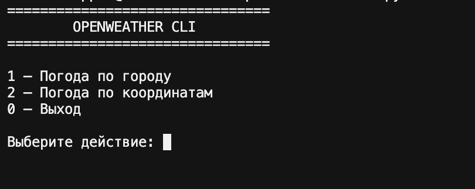
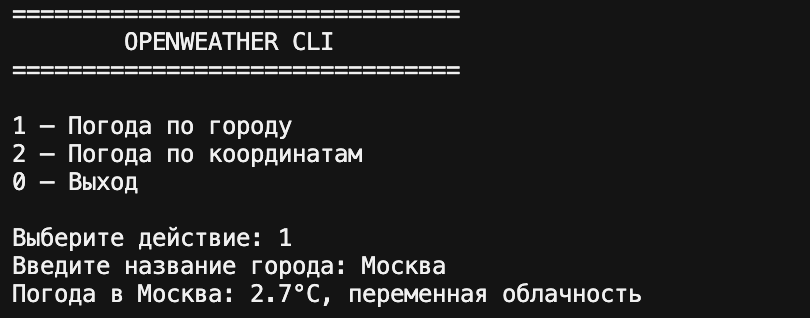
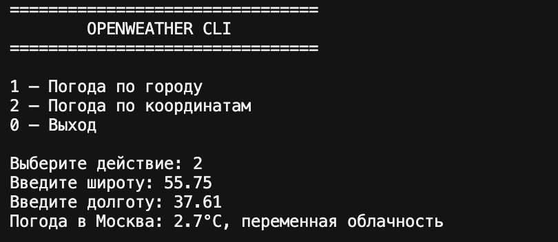
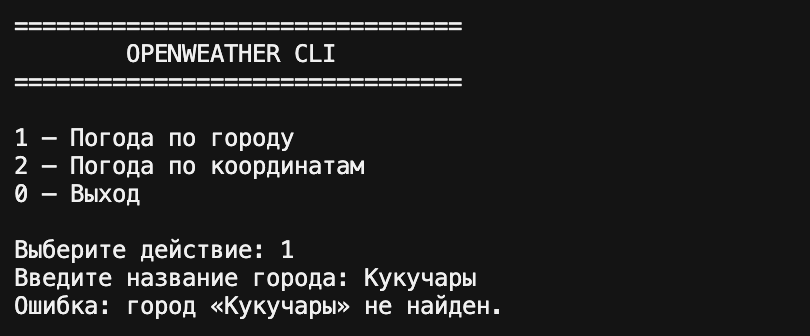
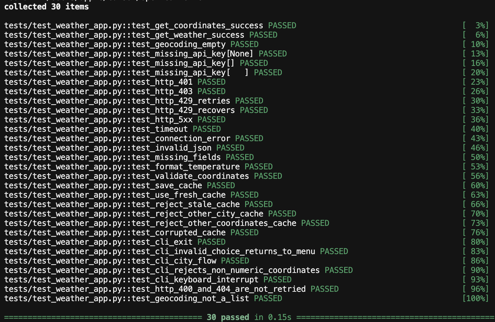

# OpenWeather CLI

Консольное приложение показывает текущую погоду по названию города или по географическим координатам. Данные запрашиваются у OpenWeather API: для города сначала выполняется геокодинг, затем запрос текущей погоды.

## Цель проекта

Проект выполнен по домашнему заданию **VPd03 «Авторизация и ключи»** курса «Профессия вайб-кодер», модуль 5 «Работа с API».

Задача — подключить ключ OpenWeather через `.env`, обработать ответы и ошибки REST API, сохранить последний успешный результат в кэше, повторить временные сбои и покрыть сценарии автоматическими тестами. Секрет остаётся только на локальной машине и в Git не попадает.

## Возможности

- Интерактивное меню: погода по городу, погода по координатам, выход.
- Геокодинг города: `https://api.openweathermap.org/geo/1.0/direct`.
- Текущая погода: `https://api.openweathermap.org/data/2.5/weather`, единицы `metric`, язык `ru`.
- Вывод в формате `Погода в Москва: 3.1°C, пасмурно` — температура с одним знаком после запятой.
- Проверка широты от -90 до 90 и долготы от -180 до 180. В числе можно использовать запятую.
- Возврат в меню после запроса. Пустой ввод, неизвестный пункт и Ctrl+C завершаются сообщением без traceback.
- Понятные сообщения для ошибок API, сети, JSON и отсутствующих полей.
- Кэш последнего успешного ответа на 3 часа.
- До трёх повторных запросов с паузами 1, 2 и 4 секунды.

## Технологии

- Python 3.11+
- [requests](https://pypi.org/project/requests/) — HTTP-запросы
- [python-dotenv](https://pypi.org/project/python-dotenv/) — чтение `.env`
- [pytest](https://pypi.org/project/pytest/) — автоматические тесты
- [OpenWeather API](https://openweathermap.org/api)

Приложение рассчитано на запуск в Терминале macOS.

## Структура проекта

```text
openweather-cli/
├── weather_app.py
├── requirements.txt
├── requirements-dev.txt
├── .env                  # локальный ключ, в Git не входит
├── .env.example
├── .gitignore
├── README.md
├── weather_cache.json    # создаётся после успешного запроса, в Git не входит
├── screenshots/
│   ├── 01_main_menu.png
│   ├── 02_weather_city.png
│   ├── 03_weather_coordinates.png
│   ├── 04_error_handling.png
│   ├── 05_tests.png
│   └── .gitkeep
└── tests/
    ├── __init__.py
    └── test_weather_app.py
```

Каталоги `.venv/`, `__pycache__/` и `.pytest_cache/` тоже исключены из Git.

## Установка на macOS

Нужен Python 3.11 или новее.

```bash
cd openweather-cli
python3 -m venv .venv
source .venv/bin/activate
python -m pip install -r requirements-dev.txt
```

`requirements.txt` ставит `requests` и `python-dotenv`. `requirements-dev.txt` подключает этот файл и добавляет `pytest`. Для одного только запуска приложения достаточно `requirements.txt`.

## Настройка API-ключа

1. Зарегистрируйтесь на [OpenWeather](https://home.openweathermap.org/users/sign_up).
2. Откройте раздел [API keys](https://home.openweathermap.org/api_keys) и скопируйте ключ.
3. Если файла `.env` ещё нет, создайте его из шаблона:

```bash
cp .env.example .env
```

4. Запишите ключ в `.env` одной строкой. Если файл уже есть, не заменяйте его.

```dotenv
API_KEY=
```

`.env.example` содержит только пустой шаблон. Сам ключ в репозиторий не кладётся: `.gitignore` исключает `.env`.

Приложение читает ключ так:

```python
import os
from dotenv import load_dotenv

load_dotenv()
API_KEY = os.getenv("API_KEY")
```

Если значение отсутствует или состоит из пробелов, программа завершается без traceback:

```text
Ошибка: API_KEY не найден. Добавьте ключ OpenWeather в файл .env.
```

Новый ключ OpenWeather иногда начинает работать через несколько минут после создания. До активации API отвечает HTTP 401.

## Запуск приложения

Из активированного виртуального окружения:

```bash
python weather_app.py
```

На экране появляется меню:

```text
================================
        OPENWEATHER CLI
================================

1 — Погода по городу
2 — Погода по координатам
0 — Выход

Выберите действие:
```

- `1` — запрос названия города, геокодинг и текущая погода.
- `2` — запрос широты и долготы, затем текущая погода.
- `0` — выход.
- После каждого запроса программа снова показывает меню.

## Примеры использования

Ниже — исторические результаты запуска **15 ноября 2026 года**. Это подтверждённый тогда ответ программы, а не актуальная погода.

По названию города:

```text
Выберите действие: 1
Введите название города: Москва
Погода в Москва: 3.1°C, пасмурно
```

По координатам 55.75, 37.61:

```text
Выберите действие: 2
Введите широту: 55.75
Введите долготу: 37.61
Погода в Москва: 3.3°C, пасмурно
```

Пример ошибки ввода:

```text
Выберите действие: 2
Введите широту: север
Ошибка: широта должна быть числом.
```

## Обработка ошибок

Ожидаемые сбои печатаются текстом. Traceback для них не показывается. Общий `except Exception` в программе не используется, поэтому ошибки самого кода остаются видимыми.

| Ситуация | Сообщение |
|---|---|
| Нет ключа | `Ошибка: API_KEY не найден. Добавьте ключ OpenWeather в файл .env.` |
| HTTP 401 | `Ошибка: недействительный или ещё не активированный API-ключ (HTTP 401).` |
| HTTP 403 | `Ошибка: доступ запрещён (HTTP 403).` |
| HTTP 404 | `Ошибка: ресурс не найден (HTTP 404).` |
| HTTP 429 | `Ошибка: превышен лимит запросов (HTTP 429). Повторите попытку позже.` |
| HTTP 500–599 | `Ошибка: временная ошибка сервера (HTTP …). Повторите попытку позже.` |
| Таймаут | `Ошибка: время ожидания ответа истекло.` |
| Нет сети | `Ошибка: отсутствует интернет-соединение.` |
| Город не найден | `Ошибка: город «…» не найден.` |
| Некорректный JSON | `Ошибка: сервер вернул некорректный JSON.` |
| Нет обязательных полей | `Ошибка: в ответе отсутствуют обязательные поля.` |

Ключ уходит только в `params` библиотеки `requests`. Адрес с параметром `appid` программа не печатает. При HTTP 401 и HTTP 403 сохранённый кэш не подставляется.

## Кэширование и повторные запросы

Успешный ответ сохраняется в `weather_cache.json`: город, координаты, время в UTC с часовым поясом и краткий блок погоды. Ключ API в файл не записывается. Файл исключён из Git.

Кэш действителен не более 3 часов. Если запрос обрывается по таймауту, из-за отсутствия сети, HTTP 429 или HTTP 5xx, программа предлагает показать сохранённый результат. Данные другого города или других координат не используются. Повреждённый файл кэша пропускается, и программа продолжает работу.

После первой неудачи временный сбой повторяется ещё до трёх раз. Паузы между попытками: 1 секунда, 2 секунды и 4 секунды. Повторяются HTTP 429, HTTP 5xx, таймаут и ошибка соединения. Ошибки HTTP 400, 401, 403, 404, некорректный JSON и неверный ввод повторно не отправляются.

## Демонстрация работы

Снимки сделаны в Терминале macOS. На них нет ключа API, содержимого `.env` и адреса запроса с параметром `appid`. Погода на скриншотах относится к моменту съёмки и отличается от исторического примера от 15 ноября 2026 года.

### Главное меню

Стартовый экран с пунктами 1, 2 и 0.



### Погода по городу

Пункт 1, город Москва: программа выводит температуру и описание на русском языке.



### Погода по координатам

Пункт 2, широта 55.75 и долгота 37.61.



### Обработка ошибки

Несуществующий город возвращает понятное сообщение, программа не показывает traceback.



### Автоматические тесты

Вывод `python -m pytest -v`: 30 тестов пройдены.



## Автоматические тесты

Тесты находятся в `tests/test_weather_app.py`. HTTP-запросы замоканы, реальный ключ в них не используется, а `time.sleep` не делает настоящих пауз.

```bash
source .venv/bin/activate
python -m pytest -v
```

Проверяются успешные координаты и погода, пустой геокодинг, отсутствие ключа, статусы 401, 403, 429 и 5xx, таймаут, обрыв соединения, некорректный JSON, отсутствующие поля, формат температуры, диапазоны координат, запись и чтение кэша, устаревший кэш, чужой город, чужие координаты, повреждённый файл и выход из меню.

Повторный запуск при обновлении README: **30 passed за 0,13 секунды** (`30 passed in 0.13s`). Предыдущий подтверждённый запуск, он же на скриншоте: **30 passed за 0,15 секунды**.

## Результаты выполнения задания

Проект посвящён безопасной работе с ключом OpenWeather и получению текущей погоды из консоли.

- Реализованы запросы по городу и по координатам, интерактивное меню и проверка ввода.
- Ключ читается из `.env`. В исходниках, документации, тестах и кэше его нет.
- Обработаны HTTP 401, 403, 404, 429, 5xx, таймаут, отсутствие сети, пустой геокодинг, некорректный JSON и отсутствующие поля.
- Кэш хранится до 3 часов. Временные сбои повторяются с задержками 1, 2 и 4 секунды.
- 15 ноября 2026 года реальный API вернул для Москвы `Погода в Москва: 3.1°C, пасмурно`, а для координат 55.75, 37.61 — `Погода в Москва: 3.3°C, пасмурно`.
- Автотесты проходят: последний запуск — 30 passed за 0,13 секунды.
- Пять скриншотов лежат в `screenshots/` и подключены в этом README.
- `.env`, `weather_cache.json`, `.venv/` и `__pycache__/` исключены из Git. `.env.example` содержит пустое поле `API_KEY=`.
